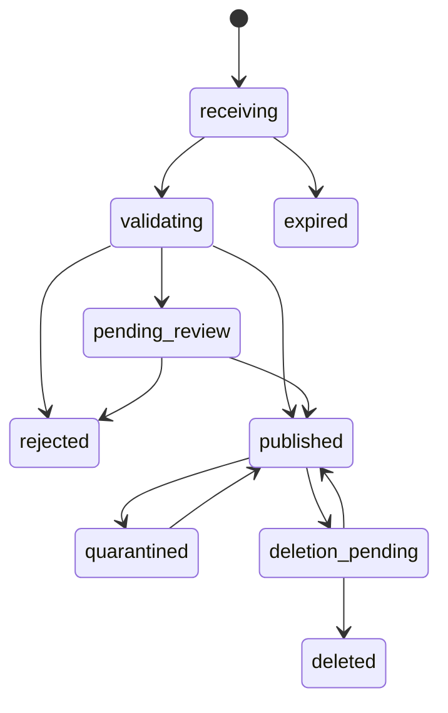

# Plano de desenvolvimento — Registry privado de pacotes e artefatos

**Data:** 02/10/2026  
**Estado:** especificação para iniciar o desenvolvimento com Codex  
**Nome de trabalho:** Private Registry; nome comercial ainda não escolhido  
**Repositório sugerido:** `artifact-registry` — sugestão técnica, sem pressupor disponibilidade

## 1. Objetivo e decisões consolidadas

Construir um registry self-hosted para hospedar, publicar e consumir pacotes privados de Dart/Flutter, Go, Rust, Node.js, Elixir/Erlang e imagens Docker/OCI, além de arquivos genéricos versionados para distribuição por URLs próprias.

A primeira instalação atende aos projetos do proprietário. O produto deve ser instalável por outras equipes e empresas, preservando simplicidade operacional, segurança e capacidade real de recuperação. Hospedagem gerenciada ou SaaS são evoluções possíveis, não requisitos para a primeira versão.

### 1.1 Decisões obrigatórias

| Tema | Decisão |
| --- | --- |
| Implantação inicial | Self-hosted, uma instância ativa por instalação |
| Backend | Go, com módulos bem delimitados no mesmo projeto |
| Frontend | SvelteKit com TypeScript |
| Banco padrão | SQLite |
| Banco opcional | PostgreSQL, com paridade funcional e testes próprios |
| Artefatos | Filesystem local ou S3 compatible, incluindo R2/MinIO |
| Publicação | Responsabilidade da fonte: desenvolvedor, repositório ou pipeline prepara e envia |
| Registry | Autentica, autoriza, valida, armazena, indexa e disponibiliza; não constrói código de clientes |
| Pacotes privados | Necessidade principal; padrão de novos repositórios |
| Pacotes públicos | Permitidos por configuração explícita |
| Proxy de registries públicos | Fora do primeiro escopo; nenhuma busca pública automática de nomes privados |
| Arquivos estáticos | Publicação explícita de bundles e assets já prontos |
| CDN | O produto oferece origem de conteúdo; distribuição geográfica depende de CDN externa |
| Backup | Online, criptografado antes do envio automático ao S3, com restauração validada |
| Autenticação | Senha opcional; OIDC próprio; Google, Apple e GitHub configuráveis |
| CAPTCHA | Turnstile, reCAPTCHA e hCaptcha configuráveis |
| Emails temporários | Bloqueio opcional, lista atualizável, regras manuais e exceções |
| Automação | Contas de serviço, tokens restritos e publicação confiável via OIDC de CI |
| Segurança | Imutabilidade, auditoria, detecção de anomalias, alertas por email e políticas de supply chain |

### 1.2 Princípios

1. A instalação é simples; a consistência, a recuperação e o isolamento são rigorosos.
2. Compatibilidade é comprovada com clientes reais, não apenas com respostas HTTP semelhantes.
3. Credenciais humanas e de automação são diferentes.
4. Permissão de operar a instalação não equivale a permissão de ler pacotes privados.
5. Uma versão aceita nunca muda de bytes.
6. Backup enviado e backup restaurado são estados distintos.
7. Origem aparente de rede é um sinal de risco, não identidade comprovada.
8. Recursos futuros não justificam microserviços, filas externas ou infraestrutura desnecessária no início.
9. Integrações externas devem ter disponibilidade e comportamento de falha explícitos.
10. Logs, alertas e métricas não podem expor segredos ou nomes privados a pessoas sem acesso.

## 2. Terminologia e escopo do produto

| Termo | Significado |
| --- | --- |
| Instalação | Instância self-hosted com banco, configuração e armazenamento próprios |
| Workspace | Fronteira de colaboração e autorização; exemplo: pessoal ou TixNow |
| Repositório | Coleção de um formato, dentro de um workspace; não é um repositório Git |
| Pacote | Identidade lógica do pacote, crate, módulo ou coleção de assets |
| Versão | Identificador aceito segundo as regras do formato |
| Blob | Conteúdo binário identificado por algoritmo/digest |
| Manifest | Documento que referencia arquivos ou blobs; inclui manifests OCI |
| Tag/alias | Referência mutável ou protegida para uma versão/digest |
| Publicador confiável | Identidade de CI explicitamente vinculada a um destino de publicação |
| Proveniência | Declaração verificável da origem e produção de um artefato |
| Quarentena | Restrição de distribuição por incidente ou verificação pendente |

### 2.1 Resultado esperado

- Compartilhar SDKs, componentes e bibliotecas internas sem publicar nos registries oficiais.
- Consumir dependências com `dart pub`, `flutter pub`, `go`, `cargo`, clientes npm e `mix`.
- Publicar e consumir imagens com clientes Docker/OCI.
- Publicar bundles como o Scalar, widgets, CSS, fontes, WASM, documentação estática e binários por URLs versionadas.
- Gerenciar permissões e credenciais numa interface comum.
- Recuperar a instalação em outra máquina usando backups reais e chaves independentes.

### 2.2 Fora do escopo inicial

- Build remoto de pacotes, transformação npm para ESM ou bundling automático.
- Importação de tags/commits de GitHub/GitLab pelo servidor.
- Espelhamento completo, proxy ou cache de registries públicos.
- CDN mundial própria, edge computing e execução de código de usuários.
- Billing, marketplace, cobrança de terceiros e SaaS compartilhado.
- Kubernetes como pré-requisito; Valkey, NATS ou Kafka como dependências obrigatórias.
- Cluster SQLite, active-active, sharding e múltiplos escritores em hosts distintos.
- Garantia de que uma dependência não é utilizada em nenhum projeto externo.
- Garantia de ausência de malware ou vulnerabilidades só por possuir assinatura.

Essas exclusões não removem as interfaces de extensão necessárias, mas não devem gerar infraestrutura antecipada.

## 3. Stack e decisões técnicas

### 3.1 Backend

| Componente | Direção de implementação |
| --- | --- |
| HTTP | `net/http` + Chi; middleware comum de identidade, autorização e limites |
| SQL | `database/sql`; driver SQLite e `pgx` via stdlib para PostgreSQL |
| Queries | SQL explícito; sqlc onde reduzir erros, com geração independente por dialeto |
| Migrations | Goose com diretórios específicos por banco e histórico verificável |
| SQLite | Avaliar `modernc.org/sqlite` para distribuição sem CGO; comprovar backup online no spike inicial |
| S3 | AWS SDK for Go v2, endpoints configuráveis, multipart e cancelamento |
| OIDC | Biblioteca mantida de verificação OIDC/JWT, discovery e JWKS; não escrever o protocolo do zero |
| Senhas | Argon2id com parâmetros versionados e rehash progressivo |
| Criptografia de backup | `filippo.io/age`, sem formato criptográfico próprio |
| Jobs | Fila persistida no banco com leases e retries |
| Observabilidade | Logs estruturados, métricas Prometheus e tracing opcional |
| IDs | UUIDv7 ou outra identidade opaca consistente; não usar slugs como chave de autorização |

Fixar versões das dependências na implementação. Selecionar versões estáveis suportadas; registrar atualizações e manter lockfiles. As bibliotecas citadas são direção técnica, não uma promessa de compatibilidade ainda testada.

### 3.2 Frontend

- SvelteKit + TypeScript, componentes acessíveis e interface responsiva.
- Priorizar `adapter-static` para a administração autenticada, com API Go e frontend servido pelo executável. Confirmar deep links e fallback apenas nas rotas da UI.
- Não aplicar fallback de SPA aos endpoints de pacotes, assets ou OCI.
- Se houver necessidade concreta de SSR, documentar ADR e custo de operar Node separado; o SSR não é pré-requisito do produto.
- Não duplicar decisões de autorização no frontend; toda operação é autorizada no Go.
- Sessão humana em cookie HttpOnly; tokens de automação nunca em localStorage.
- Preparar traduções pt-BR e en, com chaves de mensagem desde o início.

### 3.3 Estrutura sugerida

```text
artifact-registry/
  cmd/
    registry/                 # servidor + comandos de administração
    registryctl/              # publicação auxiliar e recuperação
  internal/
    identity/
    authorization/
    workspaces/
    repositories/
    catalog/
    publication/
    storage/
    protocols/
      pub/
      gomod/
      cargo/
      npm/
      hex/
      oci/
      generic/
    security/
    backup/
    jobs/
    notifications/
    audit/
    admin/
    config/
    database/
      sqlite/
      postgres/
  migrations/
    sqlite/
    postgres/
  web/                        # aplicação SvelteKit
  tests/
    fixtures/
    compatibility/
    recovery/
  deploy/
  docs/
    adr/
    runbooks/
  go.mod
  go.sum
```

Interfaces pequenas junto de quem as consome. Reutilizar regras de domínio sem forçar consultas dos dois bancos a serem idênticas. Não criar abstração genérica para toda operação de qualquer protocolo.

## 4. Arquitetura e fronteiras

### 4.1 Componentes

1. **API e administração:** workspaces, usuários, políticas, catálogo e configuração.
2. **Adapters de protocolo:** apresentam respostas e autenticação exigidas por cada cliente.
3. **Serviço de publicação:** coordena validação, armazenamento e commit.
4. **Armazenamento:** filesystem/S3, com streams, digests e reconciliação.
5. **Jobs persistentes:** emails, backup, verificação, limpeza, indexação e coleta de métricas.
6. **CLI:** configuração assistida, publicação Go/Hex/genérica e recuperação local.
7. **Motor OCI:** componente dedicado opcional para a fase Docker, integrado às políticas centrais.

Não existe transação distribuída entre SQL e S3. O desenho usa estados, objetos imutáveis e reconciliação; nunca simula atomicidade inexistente.

### 4.2 Endpoints e domínios

Exemplos ilustrativos, usando `example.com`:

| Superfície | Exemplo |
| --- | --- |
| Administração | `registry.example.com` |
| API administrativa | `registry.example.com/api/v1/` |
| Pub | `registry.example.com/pub/{workspace}/{repository}/` |
| Go | `registry.example.com/go/{workspace}/{repository}/` |
| Cargo sparse | `registry.example.com/cargo/{workspace}/{repository}/index/` |
| npm | `registry.example.com/npm/{workspace}/{repository}/` |
| Hex | `registry.example.com/hex/{workspace}/{repository}/` |
| OCI | `containers.example.com/v2/` |
| Assets executáveis | `assets.example.com/{workspace}/{repository}/{package}/{version}/{file}` |

Paths são propostas internas; os adapters devem obedecer às rotas reais de seus protocolos. Configurar URL externa canônica, proxy confiável e origens permitidas. O namespace OCI deve ser resolvido no servidor, por exemplo `{workspace}/{repository}/{image}`.

Assets HTML/JS e documentação enviados por usuários ficam fora da origem da administração. Rejeitar configuração que coloque conteúdo executável de clientes na mesma origem das sessões administrativas.

## 5. Modelagem e invariantes

### 5.1 Entidades

| Grupo | Entidades principais |
| --- | --- |
| Identidade | users, external_identities, password_credentials, mfa_credentials, recovery_codes, sessions |
| Colaboração | workspaces, memberships, teams, team_members, invitations |
| Repositórios | repositories, repository_grants, package_grants, namespace_reservations |
| Catálogo | packages, package_versions, version_files, dependency_metadata, aliases |
| Conteúdo | blobs, blob_locations, upload_sessions, blob_references |
| Automação | service_accounts, credentials, credential_scopes, trusted_publishers |
| Segurança | security_events, incidents, credential_baselines, rule_policies |
| Publicação | publications, publication_checks, attestations, signatures |
| Operação | settings, encrypted_secrets, job_queue, outbox, audit_events |
| Recuperação | backup_jobs, backup_manifests, backup_references, restore_validations |

O modelo comum é complementado por metadados próprios de cada formato. Não exigir SemVer em qualquer artefato genérico nem representar todo manifest OCI como uma versão de biblioteca.

### 5.2 Campos e restrições essenciais

- workspace e repository em toda entidade que pertença a um domínio de acesso.
- Índices únicos para identidade canônica do pacote por repositório e versão canônica por pacote.
- Normalização conforme cada protocolo, com prevenção de colisões de nomes e paths.
- Identidade externa única por `(provider_id, issuer, subject)`; email não é chave de autenticação.
- Credenciais com identificador público, hash do segredo, validade, revogação, finalidade e escopos.
- Não persistir tokens bearer completos nem argumentos que os contenham.
- Blobs com algoritmo, digest, tamanho, estado e localizações verificadas.
- Campos de auditoria: ator, tipo, alvo, resultado, request ID, timestamp e contexto mínimo.
- Estados de jobs com lease owner, lease expiry, contador de tentativas e próxima execução.
- Chaves estrangeiras, validação de integridade e constraints equivalentes nos dois bancos.

### 5.3 Invariantes

1. Download autorizado aponta apenas para objeto completo e verificado.
2. A mesma identidade de versão não aceita conteúdo diferente, mesmo depois de exclusão.
3. Um blob conhecido globalmente não concede direito de baixar seu conteúdo.
4. Operações por digest, busca, listas e mensagens de erro respeitam isolamento.
5. Upload sem commit não entra nos índices dos clientes.
6. Permissões são rechecadas ao finalizar upload, não apenas ao iniciá-lo.
7. Quotas são reservadas atomicamente; concorrência não permite exceder o limite silenciosamente.
8. Exclusão, backup e GC compartilham regras explícitas de retenção.
9. Mudanças sensíveis geram auditoria e evento de notificação de forma transacional.

Preferir deduplicação dentro do workspace no início. Deduplicação entre workspaces exige análise de side channels, quota, isolamento e autorização de cross-mount; não implementá-la implicitamente.

## 6. Fluxo de publicação

### 6.1 Pipeline comum

1. Autenticar identidade e resolver destino autorizado.
2. Validar restrições, tamanho declarado e reserva de quota.
3. Criar sessão de upload com expiração e identificador opaco.
4. Receber conteúdo em streaming, calcular digest e impor limites reais.
5. Validar arquivo, metadados e correspondência de nome/versão.
6. Aplicar verificações e exigências de assinatura/proveniência.
7. Tornar objetos duráveis e verificar disponibilidade no storage.
8. Em transação, reservar definitivamente a versão, registrar referências, auditoria e outbox.
9. Expor a versão nos endpoints nativos e disparar jobs derivados.

### 6.2 Estados



Depreciação e retirada da resolução são atributos específicos de ecossistema, não sinônimos de exclusão física. Restaurar da quarentena ou de exclusão pendente exige decisão autorizada e justificada.

### 6.3 Falhas e concorrência

- Upload concluído no S3, mas commit SQL falhou: objeto órfão fica retido por grace period e é reconciliado.
- Dois publicadores enviaram a mesma versão: constraint decide um vencedor; retry só é idempotente com os mesmos bytes e metadados protegidos.
- Timeout depois do commit: operação pode consultar recibo ou repetir de forma idempotente.
- Multipart abandonado: job aborta, libera quota e registra resultado.
- Usuário perdeu permissão durante upload: finalização negada.
- Job de scanner atrasou: publicação obrigatoriamente verificada permanece indisponível; não liberar por timeout.
- ÍNDICE e conteúdo: resposta de sucesso não pode preceder a disponibilidade exigida pelo cliente.

O registry nunca executa `npm install`, `mix compile`, `cargo build`, hooks de pacote ou comandos arbitrários de README. Extração e inspeção são operações limitadas, preferencialmente em ambiente isolado.

## 7. Compatibilidade por formato

Cada adapter precisa de contrato, fixtures, testes com cliente e matriz de versões suportadas. O dashboard deve declarar comandos compatíveis e limitações concretas; não usar um selo genérico de suporte antes desses testes.

### 7.1 Dart e Flutter — Pub

- Implementar Hosted Pub Repository API, incluindo consulta, download e publicação autenticada.
- Validar pacote e `pubspec.yaml`, limites do archive e correspondência de versão.
- Suportar tokens e configuração `publish_to`/hosted por dependência.
- Gerar instruções para `dart pub` e `flutter pub`; não substituir globalmente pub.dev quando só se quer dependências privadas.
- Tratar URLs de archive, erros e metadados conforme o cliente.
- Manter retirada/depreciação de versões nos recursos suportados pelo Pub.
- Não exigir Flutter no servidor nem compilar plugins nativos.

Aceite: publicar uma biblioteca Dart e um pacote Flutter, instalar ambos com clientes reais, resolver dependência transitiva privada e impedir acesso sem credencial. Referências: [R1], [R2].

### 7.2 Go — módulos

- Consumo por `GOPROXY`: listagem, latest, `.info`, `.mod` e `.zip`.
- Publicação própria autenticada: a fonte envia o conjunto da versão; nenhuma leitura de Git pelo servidor.
- Usar `golang.org/x/mod` no empacotamento/validação e respeitar regras de módulo e ZIP.
- Validar compatibilidade entre module path, versão e major version, além de escaping do path.
- A CLI empacota localmente e envia; aceitar publicação por API sem a CLI.
- Pseudo-versions exigem suporte explícito e testes; não inventar origem VCS a partir de timestamp.

Configuração ilustrativa quando todos os módulos do cliente passam por este destino privado:

```text
GOPROXY=https://registry.example.com/go/pessoal/modules
GONOPROXY=none
GONOSUMDB=go.example.com
```

A UI deve gerar configuração compatível com a estratégia do cliente, documentar autenticação suportada pela versão do Go e preservar checksum público para módulos públicos. Não recomendar `GOSUMDB=off` global. Fallback externo não deve consultar nomes privados: usar proxy interno que falha de forma terminal para namespaces reservados, ou encaminhamento exclusivamente privado; testar também descoberta por prefixos. Referências: [R3], [R4].

No uso misto, o cliente pode consultar primeiro o registry e depois o proxy público, sem que o registry espelhe conteúdo público. O adapter retorna indisponibilidade com fallback apenas para caminhos não privados; namespaces privados ausentes produzem erro terminal compatível com o cliente. Não usar fallback por qualquer erro nem configurar `GOPRIVATE` sem ajustar `GONOPROXY` quando o módulo deve passar pelo registry.

Aceite: `go mod download`, `go get`, versão major v2, dependência privada transitiva e ausência de consulta pública do namespace privado em testes com rede observada.

### 7.3 Rust — Cargo

- Índice sparse autenticado, `config.json`, archive `.crate` e API de publicação.
- Metadata de dependências, features e registries preservada segundo o protocolo.
- Yanking por versão; o comportamento de lockfiles deve ser demonstrado com Cargo real.
- Configuração de credential provider e tokens compatível com os clientes suportados.
- URLs de índice com `sparse+` e configuração por registry nomeado.
- Não hospedar índice Git na primeira entrega, salvo necessidade comprovada.

Aceite: `cargo publish`, `cargo build`, crate com features e dependência privada transitiva, yank e uso com lockfile. Referências: [R5], [R6].

### 7.4 Node.js, TypeScript e SvelteKit — npm

- Metadata/packuments, tarballs, versões, integridade, scopes e dist-tags.
- Publicar e consumir pacotes como `@tixnow/ui`, `@tixnow/api-client` e `@tixnow/shared`.
- `.npmrc` por scope e credencial vinculada ao host/path correto.
- Suportar token pré-configurado; login interativo apenas nos modos efetivamente implementados.
- Permissões de publicação separadas de mover dist-tags e de remover versões.
- Preservar `exports`, tipos, dependências e campos necessários para pacotes Svelte.
- Compatibilidade npm obrigatória; pnpm, Yarn e Bun entram na matriz somente após testes.
- Sem promessa de API de audit de registry público; exibir claramente se não implementada.

Aceite: `npm publish`, `npm ci`, integridade, atualização protegida de dist-tag e consumo de componente Svelte em um projeto SvelteKit. Referências: [R7], [R8].

### 7.5 Elixir/Erlang — Hex

- Repositório autenticado, tarballs e registry assinado com chave gerenciada.
- Indexação e distribuição compatíveis com Mix/Hex e metadados de dependências.
- Primeiro caminho de publicação: fonte executa `mix hex.build` e envia tarball pela API/CLI.
- Gerar instruções de registro do repository, autenticação e chave pública confiável.
- A geração de metadados de distribuição assinados é responsabilidade do registry, não build do pacote.
- Compatibilidade com publicação nativa `mix hex.publish` depende da API/configuração Hex efetivamente implementada. Não pressupor uma opção `--repo` inexistente nem considerar self-hosting estático uma API completa de publicação.
- Primeiro consumo: `mix deps.get`; suporte adicional a rebar3 e docs precisa de testes separados.
- Mudança da chave de assinatura exige distribuição de confiança e preservação das chaves necessárias à recuperação.

Aceite: publicar tarball já construído, instalar com Mix, resolver pacote privado transitivo, rejeitar metadata alterada e validar restauração de repositório assinado. Referências: [R9], [R10].

### 7.6 Docker/OCI

**Direção inicial:** integrar CNCF Distribution como data plane OCI opcional, em processo/container separado, sem escrever um registry completo do zero. Esta escolha precisa de um spike antes de implementação definitiva.

- Compatibilidade com push/pull, HEAD, manifests, blobs, tags, uploads interrompidos e imagens multiplataforma.
- Token service central com audience, escopos push/pull e expiração curta.
- Todas as requisições passam por gateway confiável; o motor OCI não é exposto diretamente.
- Gateway verifica autorização/revogação atual e aplica quotas, bloqueios e auditoria.
- Configurar storage local/S3 do motor pela administração com mudanças controladas e validação.
- Catálogo da UI é projeção reconciliável; manifests no motor são a fonte de verdade OCI.
- Upload de manifest só é liberado depois das verificações obrigatórias; guardar recibo e reconciliar projeção se o commit no catálogo falhar.
- Não contar somente eventos de push: incluir reconciliação de manifests/tags reais.
- Referrers, assinaturas e SBOM devem ser testados na versão escolhida do motor.
- Cross-repository mount exige acesso ao destino e à origem; entre workspaces fica desabilitado inicialmente.

**Decisão de aceite do spike:** comprovar gate de publicação, isolamento, quotas, revogação, exportação/restauração e integração de GC. Se o motor não permitir as garantias, registrar ADR e adotar adapter OCI próprio ou backend alternativo; não entregar um bypass de segurança silencioso.

O formato interno do storage OCI não se mistura implicitamente ao CAS dos demais pacotes. Backup e GC têm adapters próprios e coordenação central. Referências: [R11], [R12].

### 7.7 Artefatos genéricos e assets

- Publicação de coleção versionada com manifest de arquivos: path, tamanho, MIME, digest e política de acesso.
- Paths relativos normalizados; impedir traversal e colisões; não servir arquivos fora da coleção.
- Upload de arquivo individual ou archive com extração limitada.
- Downloads via GET/HEAD, ETag e Range nos casos suportados.
- URLs de versões imutáveis com cache longo para conteúdo público; aliases mutáveis têm cache curto e proteção própria.
- CORS e Content-Type configurados com defaults restritos; `nosniff`.
- HTML/JS/SVG enviados por usuários nunca na origem da administração.
- URL privada exige credencial compatível ou link assinado de vida curta. Nunca colocar token permanente num `<script src>`.
- UI oferece URL de cada arquivo, snippet, hash/SRI quando aplicável e opção de download.
- Origem própria pode estar atrás de CDN externa, sem cache compartilhado de conteúdo privado por default.

Aceite: servir bundle pré-construído do Scalar e um widget próprio por versão, validar integridade, Range e separação de origem. O registry não precisa resolver dependências nem transformar arquivos. Referência contextual: [R13].

## 8. Autenticação humana e cadastro

### 8.1 Bootstrap

1. Instalação inicia em modo de configuração, com segredo de bootstrap entregue por canal local.
2. Primeiro administrador define URL externa, conta inicial, banco e armazenamento.
3. Criar material de chave e exportar kit de recuperação.
4. Testar configuração antes de ativar métodos externos.
5. Encerrar bootstrap definitivamente; impedir tomada da instalação por nova visita pública.

Cadastro fechado por padrão. Opções: somente administradores, convites, ou cadastro aberto. Convites têm expiração, escopo, uso único e estado verificável. Convites para workspaces diferentes não concedem acesso à instalação inteira.

### 8.2 Métodos

| Método | Requisito |
| --- | --- |
| Senha local | Opcional; senha forte, hash Argon2id, reset de uso único e rate limit |
| OIDC próprio | Configuração de issuer, client ID/secret, scopes e mapeamento de claims |
| Google | Adapter configurável com identidade estável e callbacks registrados |
| Apple | Adapter com configurações e rotação de credenciais próprias do provedor |
| GitHub | OAuth configurável; consultar identidade estável e email verificado quando exigido |
| Passkeys/TOTP | Segundo fator e/ou autenticação local conforme implementação |

OIDC próprio significa integrar um provedor externo controlado pelo operador, como um IdP corporativo. Não significa construir um servidor de identidade próprio. GitHub para login humano e OIDC de GitHub Actions são integrações distintas.

Fluxos de login: authorization code, PKCE onde suportado, `state`, `nonce` em OIDC, redirect URI fixa e validação dos tokens. Validar emissor, assinatura, audiência e validade usando biblioteca mantida. Não aceitar algoritmos arbitrários nem URLs de discovery fornecidas por usuários comuns. Referência normativa: [R14].

### 8.3 Contas e sessões

- Vinculação de provedor exige sessão recente e confirmação explícita.
- Nunca mesclar contas automaticamente só porque o email coincide.
- Grupos OIDC podem mapear para equipes; mapeamentos são allowlists controladas.
- Exigir regras explícitas para privilégios elevados; não interpretar qualquer claim como administração.
- Desativar senha somente após testar login alternativo de administrador e confirmar recuperação local.
- Verificação de email quando a política exigir; suporte a email relay da Apple sem classificá-lo automaticamente como temporário.
- Sessões revogáveis, cookie Secure/HttpOnly/SameSite e defesa CSRF nos endpoints humanos.
- Rotacionar sessão no login, MFA e mudança de privilégio.
- Duração inicial sugerida: 12 horas absolutas e 1 hora de inatividade; ajustável.
- Reautenticação recente para alterar IdP, credenciais, permissões, backups, chaves e visibilidade.
- Banimento/suspensão revoga sessões e acessos dependentes, com ações explícitas sobre contas de serviço administradas pelo usuário.
- Não confiar em logout federado como única revogação local.

### 8.4 CAPTCHA e domínio temporário

- Providers: Turnstile, reCAPTCHA e hCaptcha; opção de desligar.
- Seleção de versão/modalidade do reCAPTCHA é explícita e testada; não tratar v2, v3 e Enterprise como equivalentes.
- Verificação server-side, hostname/action quando aplicável, validade e replay conforme provedor.
- Aplicar em cadastro, recuperação e login suspeito; nunca exigir challenge HTML de `cargo`, `go`, npm ou Docker.
- Falha do provider: default negar o fluxo protegido com mensagem clara; administrador pode configurar política alternativa documentada.
- Bloqueio de domínios temporários opcional; normalização, listas versionadas, atualizações verificadas, inclusões e exceções.
- Não remover acesso de conta existente silenciosamente quando a lista mudar.
- Teste de conexão e challenge antes de ativar política global.

Referências de CAPTCHA: [R15], [R16], [R17].

## 9. Autorização e privacidade

### 9.1 Papéis

| Papel | Capacidades |
| --- | --- |
| Administrador da instalação | Saúde, configurações, armazenamento, backups e operação |
| Proprietário do workspace | Membros, repositórios e políticas do workspace |
| Administrador do workspace | Gestão delegada conforme configuração |
| Leitor | Listar e baixar conteúdo autorizado |
| Publicador | Publicar em pacotes permitidos; sem gerir membros ou apagar versões |
| Mantenedor | Depreciar, retirar da resolução e gerir referências dentro do escopo |
| Responsável de segurança | Investigar incidentes e quarentenar conforme concessões explícitas |

Permissões específicas: criar pacote, publicar versão, mover alias, mudar visibilidade, transferir ownership, quarentenar, restaurar, excluir definitivamente e gerir credenciais. Papéis prontos reduzem configuração repetitiva; exceções por pacote são possíveis, não obrigatórias.

### 9.2 Regras

- Negar por padrão e resolver contexto antes de qualquer leitura de storage.
- Administração da instalação não concede download automático de conteúdo privado.
- O operador do host/storage tecnicamente pode acessar bytes e backups: a separação da UI é controle de autorização, não criptografia ponta a ponta.
- Qualquer acesso administrativo excepcional a conteúdo exige procedimento auditado e concessão explícita; não adicionar endpoint universal de impersonation.
- Pacotes públicos continuam exigindo autenticação para publicação e gestão.
- Busca, paginação, tamanho, contadores e erros não revelam existência de pacotes privados.
- Credencial de uma conta de serviço não herda tudo que o criador pode fazer.
- Mudança privado → público exige confirmação, reautenticação e aviso de irreversibilidade de cópias externas.
- Mudança público → privado não recolhe cópias já baixadas/cacheadas; requer invalidação controlada das rotas da instalação.

## 10. Contas de serviço, tokens e trusted publishing

### 10.1 Tokens persistentes

- Secret aleatório de alta entropia com prefixo/ID identificável e segredo exibido uma vez.
- Hash/HMAC verificável para armazenamento; tokens de alta entropia não precisam do mesmo KDF lento das senhas.
- Validade obrigatória por padrão; sugestão inicial 30 dias, teto configurável.
- Separar leitura, publicação e manutenção; sem emissão de token administrativo amplo por default.
- Escopos por workspace/repository/package e operações permitidas.
- Restrições opcionais de CIDR, janela de horário e ambientes esperados.
- Rotação com breve sobreposição explicitamente configurada; revogação independente das chaves antigas.
- Last-used atualizado de forma agregada para evitar uma escrita SQL por download.
- Nenhum token em logs, URLs, exemplos persistidos, emails ou respostas posteriores.

### 10.2 OIDC de CI

1. Administrador cadastra publisher e destino autorizado.
2. Pipeline obtém JWT do issuer permitido.
3. Registry verifica JWKS, algoritmo, issuer, audience, tempo e claims.
4. Comparar identidade estável de owner/repository quando disponível, workflow e branch/tag/environment permitidos.
5. Emitir credencial curta compatível com o cliente de publicação.
6. Restringir credencial ao pacote/repositório e operação necessária.

Default sugerido: 5 minutos, com limite máximo ajustável de 15 minutos. Prever duração suficiente para uploads autorizados sem prolongar a credencial arbitrariamente; rechecagem no commit e autorização limitada da sessão de upload.

- Não aceitar qualquer repository da mesma organização automaticamente.
- Regras para PRs e forks são restritas por padrão; releases confiáveis vêm de refs autorizadas.
- Cache de JWKS limitado e atualização controlada; falha de validação nunca libera publicação.
- Mitigar replay do JWT de troca quando houver identificador/hash estável, guardando uso até expirar.
- OIDC não garante que cada uso posterior do bearer vem do runner: o bearer ainda pode ser roubado e monitorado.
- Suportar runners self-hosted; país diferente ou IP doméstico não torna identidade inválida.
- Credencial emitida não permite alterar configurações, criar outra credencial ou trocar visibilidade.

Referência GitHub: [R18]. Clientes com tokens próprios recebem a credencial curta no formato suportado; não precisam aprender OIDC diretamente.

## 11. Detecção de abuso e notificações de segurança

### 11.1 Modelo de evento

Guardar identificador de credencial/conta, resultado de autenticação, operação, recurso autorizado, IP observado, ASN/país aproximados, timestamp e sinais disponíveis. Contexto de OIDC verificado é marcado separadamente de headers declarados pelo cliente.

Capturar endereço remoto; aceitar `Forwarded`/`X-Forwarded-For` somente de proxies cadastrados. Não confiar no primeiro IP de um header arbitrário. Usar base GeoIP local atualizável como direção inicial, com licença e data de atualização registradas.

### 11.2 Regras iniciais determinísticas

| Sinal | Default | Observações |
| --- | --- | --- |
| País/ASN novo após baseline | Alerta agrupado | Não comprova comprometimento |
| Uso simultâneo em redes muito distintas | Alta prioridade | Considerar paralelismo legítimo de CI |
| Violação de CIDR explicitamente permitido | Negar + alertar | Restrição vinculante |
| Tentativa de publicar fora do escopo | Negar + auditar | Agrupar repetição |
| Token revogado/expirado em uso repetido | Negar + alertar | Pode ser pipeline desatualizado |
| Credencial de download tentando administrar | Negar + alertar | Violação objetiva |
| Pico de volume/egress | Alertar + limites | Baseline e quota por conta |
| JWT OIDC inválido ou publisher diferente | Negar + alertar | Não confundir tentativa sem token com identidade reconhecida |
| Troca de políticas, chaves ou ownership | Notificar | Evento administrativo sensível |

Baseline começa em modo de observação; mostrar quando não há dados suficientes. Mudanças de baseline precisam de aprovação ou histórico confiável, não aprendizagem automática irrestrita que normalize um ataque. IP de GitHub/cloud e User-Agent são sinais fracos; não provam repository ou workflow. Referência operacional: [R19].

### 11.3 Ações

- Observar; notificar; limitar; suspender publicação; suspender credencial; quarentenar uma publicação.
- Violações explícitas são bloqueadas imediatamente.
- Mudança geográfica isolada só alerta por padrão.
- Suspensão automática por risco elevado exige política configurada, simulação e exceções visíveis.
- Ação humana para reativação exige reautenticação e justificativa.
- Suspender identidade suspeita não apaga automaticamente suas publicações anteriores.

### 11.4 Email e entrega

- Destinatários: responsáveis da conta de serviço e equipe de segurança autorizada.
- Conteúdo: ID/nome da credencial, workspace, ação, horário, IP, região aproximada, motivo, medida aplicada e link autenticado.
- Não incluir bearer, reset token, chave privada ou conteúdo do pacote.
- Outbox transacional, jobs idempotentes, retry com backoff/jitter e dead-letter visível na UI.
- Cooldown, agrupamento e severidade evitam inundação; incidentes críticos não ficam escondidos em resumos diários.
- Entrega aceita pelo provider não significa leitura/chegada à caixa; registrar status correto.
- Alertas aparecem na UI mesmo quando o email falha; falha contínua de notificação é evento operacional.
- Webhooks futuros podem usar HMAC e retry, mas não são requisito da primeira instalação.

## 12. Segurança de supply chain

### 12.1 Controles obrigatórios

- Imutabilidade de identidade de versão, conteúdo e digest.
- Namespace reservado mesmo após exclusão; sem takeover automático.
- Credencial não pode criar pacotes arbitrários fora da allowlist ou mover referências protegidas.
- Limites de archive: bytes comprimidos/descomprimidos, número de entradas, profundidade e tempo.
- Rejeitar traversal, caminhos absolutos, entradas duplicadas, links perigosos e nomes conflitantes.
- Sanitizar README/changelog; conteúdo ativo de clientes fica em origem separada.
- Não seguir URLs de upload/download/attestation fornecidas pelo pacote sem validação; preferir envio de bytes.
- Configurações externas de admins exigem limites de egress/SSRF apropriados. MinIO privado legítimo é permitido explicitamente, não por bypass global.
- Separar upload, publicação aprovada e download disponível.
- Implementar proteção de alias/tag e propriedade do pacote.
- Mensagens e metadata de protocolo não revelam tokens nem rotas internas.

### 12.2 Assinaturas e proveniência

- Armazenar assinatura/attestation associada ao digest real recebido.
- Verificar identidade, cadeia de confiança e política de builder antes de aceitar como verificada.
- Campos declarados pelo próprio publicador, como commit SHA, não recebem selo de origem verificada sem evidência.
- Permitir política por repositório: opcional, alertar ou obrigatória.
- Escolher ecossistema de verificação interoperável, como Sigstore/in-toto/SLSA, depois de spike e threat model.
- Suportar verificação offline com bundles quando apropriado; não tornar transparency log público um vazamento obrigatório de metadata privada.
- Proveniência comprova afirmações verificadas sobre origem; não garante ausência de vulnerabilidade.
- Consumidores também devem verificar quando seu cliente/ferramenta permite; um servidor comprometido não é neutralizado por metadata servida por ele mesmo.

Referência de modelo de ameaça: [R20]. O produto não deve anunciar nível SLSA sem avaliação dos requisitos aplicáveis ao processo de build da fonte.

### 12.3 Scanners opcionais

Integrações futuras para vulnerabilidades, segredos e SBOM. Um worker separado e isolado inspeciona conteúdo sem executar scripts do pacote. Definir versão do scanner, timestamp da base, resultados, bypass autorizado com prazo e comportamento de falha.

Scanners obrigatórios para um repositório impedem publicação até resultado válido; resultados desconhecidos não viram aprovação. O núcleo pode estar pronto antes desses scanners, mas a interface não oferece uma opção sem efeito.

### 12.4 Cadeia de entrega do próprio registry

- CI do produto com permissões mínimas, dependências fixadas e actions de release fixadas por commit.
- Releases do binário e containers com checksums, assinaturas e SBOM.
- Testar upgrades e recuperação antes de promover release.
- Sem auto-update remoto silencioso ou execução de script externo pela UI.
- Canal documentado de reporte de vulnerabilidades e política de atualização.

## 13. Armazenamento, quotas e consistência

### 13.1 Drivers

Interface mínima: abrir, escrever staging, finalizar objeto, HEAD/verificar, ler range, listar para reconciliação, apagar autorizado e abortar multipart. Opções específicas de S3 permanecem específicas; não fingir que filesystem e object store têm o mesmo modelo.

- Local: diretório persistente, staging separado, escrita temporária + rename atômico no mesmo filesystem e política de durabilidade.
- S3: endpoint, region, bucket, prefix, path-style quando necessário, TLS, credenciais e testes de capacidades.
- Segredos armazenados criptografados com chave externa ao banco.
- Verificar digest próprio; ETag de multipart não é SHA-256 do conteúdo.
- Sem carregar pacote/imagem inteira em RAM.
- Pre-signed upload somente com commit que verifica tamanho/digest e limita destino; upload direto não publica automaticamente.
- Revogação de URL assinada depende de TTL/medidas no storage; mostrar essa janela na UI.

### 13.2 Quotas e contabilização

- Quota de workspace/repositório, upload individual e concorrência.
- Contabilizar bytes lógicos e físicos separadamente; referências deduplicadas não somam storage físico fictício.
- Reservar orçamento de upload; ajustar pelo tamanho real e liberar em abort/reject.
- Cotas de tráfego e requisições opcionais; defaults não podem inviabilizar builds normais.
- Billing não é implementado; métricas não precisam de precisão financeira.

### 13.3 Mudança de storage

Mudança de bucket/path não move objetos por mágica. Implementar job de cópia/verificação, leitura de ambas localizações durante transição, atualização de referências e remoção final só após validação. Se esse recurso ainda não estiver pronto, permitir apenas procedimento offline documentado e impedir alteração destrutiva pela UI.

## 14. SQLite, PostgreSQL e migrations

### 14.1 SQLite

- Arquivo em volume local persistente; WAL, foreign keys, busy timeout e configuração de durabilidade.
- Default conservador `synchronous=FULL`; tuning futuro é explícito e medido.
- Uma instância ativa; separar conexões/leitura e serializar escrita conforme driver escolhido.
- Transações curtas, checkpoint monitorado e queries indexadas.
- Não hospedar WAL em filesystem de rede nem compartilhar banco entre hosts. Referência: [R21].
- Testar backup online com driver real antes de escolher o driver definitivamente.
- Não considerar locks do banco uma substituição para invariantes transacionais de quota/versionamento.

### 14.2 PostgreSQL

- Mesmas regras de domínio, diferenças SQL encapsuladas em adapter.
- Pool configurável, TLS e usuário da aplicação com privilégios mínimos.
- Usuário de migration pode ser separado do runtime.
- CI com PostgreSQL para migrations e regras críticas desde a fundação.
- Suporte PostgreSQL não significa que múltiplas instâncias já são suportadas; leases, rate limit e caches compartilhados precisam de validação própria para isso.

### 14.3 Migrations e upgrades

- Arquivos versionados por dialeto com equivalência de schema e constraints.
- Checksum, lock de exclusão de migration e histórico de sucesso/falha.
- Instalação nova pode migrar durante bootstrap; upgrade de produção por comando explícito/controlado.
- Executável verifica intervalo de schema compatível e recusa iniciar se incompatível.
- Antes de migration destrutiva, exigir backup completo validado e espaço/tempo suficiente.
- Se backup obrigatório falha, upgrade falha de forma segura; não continuar automaticamente.
- Migration não transacional exige plano de retomada documentado.
- Não prometer rollback por migration down; preferir forward-fix ou restaurar backup compatível.
- Voltar binário é permitido somente dentro da compatibilidade declarada de schema.
- Backup pós-upgrade e validação com cliente real completam o procedimento.

### 14.4 Troca SQLite → PostgreSQL

Recurso separado, não confundir com migrations normais. Exportar dados em formato lógico versionado, entrar em manutenção de escrita, importar em banco vazio, preservar IDs/referências, validar contagens/digests e trocar configuração com backup preservado. Inicialmente pode ser CLI; não anunciar migração online entre bancos sem implementação e testes.

## 15. Backups online criptografados para S3

### 15.1 Garantias e limites

Backup deve recuperar a instalação sem depender do banco ou bucket original. Default: **backup completo**, incluindo banco, configuração recuperável, chaves internas necessárias e todos os artefatos referenciados, em destino S3 separado.

Não chamar de completo um backup que só guarda caminhos do bucket de produção. Uma modalidade futura baseada em snapshots/version IDs do storage precisa de classificação própria, retenção coordenada e aviso de dependências externas.

Online significa que leitura e operação continuam disponíveis. Pequenas barreiras de commit podem ser necessárias para coordenar metadados mutáveis e OCI; informar duração e medir impacto. Não prometer zero espera em toda publicação.

### 15.2 SQLite: snapshot antes do envio

A Online Backup API gera snapshot consistente em um banco destino e pode copiar incrementalmente enquanto a origem permanece em uso. Usar arquivo temporário protegido e limitado; depois comprimir quando útil, criptografar em streaming e enviar ao S3. Nunca copiar apenas o `.db` ativo ignorando WAL. Referência: [R22].

**Correção técnica da ideia preliminar:** não exigir que páginas do SQLite em alteração sejam transmitidas diretamente ao S3 sem snapshot estável. O envio é direto/automático ao destino remoto; não há exportação manual. A implementação inicial usa espaço temporário limitado para o snapshot do banco, não uma cópia local de todos os artefatos.

- Verificar espaço livre antes de começar, quotas do temporário e permissões 0600.
- Backup em passos pequenos com timeout, progresso e cancelamento.
- Reinícios por escrita concorrente tratados; se houver starvation, falhar com estado claro ou aplicar janela de coordenação configurada.
- Limpar temporários em falha/restart; não prometer secure erase em SSD.

### 15.3 PostgreSQL

Backup lógico consistente com `pg_dump`/`pg_restore`, binários compatíveis e warnings tratados. O adapter pode enviar a saída para criptografia/upload sem arquivo local completo do dump. Não colocar senha em argumentos de processo.

Referência: [R23]. Backup lógico da aplicação não fornece PITR nem backup de cluster/roles globais; para instalações maiores, documentar integração complementar de backup físico/WAL do operador.

### 15.4 Consistência entre banco e blobs

1. Criar job durável e adquirir proteção de GC/deletes físicos.
2. Capturar snapshot consistente do banco e inventário OCI coordenado.
3. Derivar conjunto de objetos referenciados pelo snapshot, não pelo banco vivo posterior.
4. Fixar essas referências com pins duráveis do job.
5. Liberar barreira curta de metadados; manter pins até finalizar/abortar.
6. Ler objetos imutáveis, validar digests, criptografar e copiar ao destino.
7. Persistir manifest e marcador de conclusão somente depois de todos os uploads.
8. Registrar recibo, resultado e elegibilidade para validação.

GC e backup usam locks/leases que sobrevivem a restart. Job expirado não libera referências sem reconciliação de seu estado. Lifecycle externo do bucket não pode apagar objetos protegidos: validar/documentar esse requisito.

Para OCI, exportar inventário consistente de manifests, tags, configurações e blobs alcançáveis. O gateway bloqueia operações mutáveis necessárias durante a captura e mantém GC do motor coordenado. A validação deve conseguir reconstruir o motor a partir do export; índices do dashboard sozinhos não são backup OCI.

### 15.5 Formato de backup

Prefixo remoto por installation ID e backup ID. Manifest lógico versionado contendo:

- engine/schema/app version e timestamps da captura/conclusão;
- snapshot do banco e inventário de objetos, digests e tamanhos;
- configuração exportada e catálogo de chaves internas;
- recipient/key IDs e identificação da política criptográfica;
- dependências externas que precisem ser reconfiguradas;
- número de arquivos, bytes, erros e status da validação posterior.

Banco, manifest sensível e objetos são criptografados. Metadados externos mínimos não revelam nomes privados. Manifest de conclusão autenticado impede que conjunto incompleto pareça utilizável. Integridade/autenticação de ciphertext não prova quem criou o backup: validar origem pelo destino autorizado/recibo e, quando necessário, assinatura separada com chave confiável.

### 15.6 Chaves e criptografia

- Preferir age com recipients explícitos, sem criptografia caseira. Referência: [R24].
- Chave pública de backup fica na instalação; chave privada de recuperação pode ficar fora dela.
- Exportar kit de recuperação no setup e testar sua utilização.
- Chave que decripta o backup não pode existir somente dentro dele.
- Secrets da aplicação e chaves de assinatura Hex/OCI necessários à restauração entram no backup protegidos; chave raiz externa da aplicação precisa de cópia envolvida recuperável ou provisão separada documentada.
- Rotação: novos backups usam novos recipients; antigos continuam recuperáveis até expirar.
- Não excluir chaves antigas ainda usadas por backups retidos.
- Automação da validação exige acesso protegido à chave de decriptação num verificador. Modo com chave offline só valida após fornecimento manual; não alegar validação automática sem essa capacidade.

### 15.7 Operação e defaults

Sugestões iniciais, ajustáveis: backup completo diário; retenção de 7 diários, 4 semanais e 3 mensais; validação automática completa do mais recente ao menos semanal e antes de upgrade destrutivo. As regras selecionam backups por ID sem duplicar desnecessariamente.

- Informar custo estimado em bytes e dependência de tráfego, sem inventar preço do provider.
- Destino separado e credenciais restritas; configuração de write e prune pode usar credenciais diferentes.
- Multipart com retries/cancelamento; abortar partes órfãs e não concluir manifest em falha.
- Object Lock/versionamento quando disponíveis são proteção adicional, não dependência universal.
- Não rodar prune se não houver backup válido e recuperável mais recente conforme política.
- Notificar falha, atraso e ausência de restauração validada; job interrompido nunca vira sucesso.

## 16. Restauração e comprovação de recuperação

### 16.1 Estados visíveis

`preparing → snapshotting → uploading → completed → validating → validated`.

Estados de falha/cancelamento com motivo e etapa. `completed` significa upload concluído; `validated` exige leitura do backup remoto e restauração real. Validação parcial é marcada como parcial.

### 16.2 Verificador isolado

- Baixar ciphertext do destino remoto, não reutilizar apenas o snapshot local.
- Decriptar com credencial de recuperação e verificar todos os arquivos/digests.
- Restaurar banco vazio e storage isolado, sem tocar produção.
- Executar integridade SQLite ou verificações equivalentes PostgreSQL, foreign keys, schema e referências.
- Validar disponibilidade e bytes de todos os objetos inventariados numa validação completa.
- Executar smoke tests de metadados/download de cada formato presente no backup.
- Verificar assinatura Hex, OCI manifests/layers e assets.
- Bloquear envio de emails, webhooks, cron de produção e acesso a destinos reais no ambiente de validação.
- Limitar recursos e limpar ambiente; registrar relatório, versão do verificador e duração.

Pode usar processo/container isolado. Docker não é requisito da instalação básica; validação SQLite/local pode rodar em subprocesso isolado, enquanto PostgreSQL/OCI requerem recursos explicitamente disponibilizados pelo operador.

### 16.3 Restaurar instalação nova

1. Iniciar em modo recovery sem cadastro público.
2. Fornecer destino, backup e material de chave por canal seguro.
3. Verificar origem/integridade e compatibilidade de versões antes de aplicar.
4. Restaurar banco e objetos em destinos vazios/staging.
5. Validar e testar protocolos.
6. Reconfigurar hostnames/callbacks externos necessários.
7. Revogar sessões humanas e credenciais curtas; por padrão suspender tokens persistentes até decisão do operador.
8. Manter account/service identities, mas renovar segredos potencialmente comprometidos.
9. Promover destinos e liberar serviço somente após validação.

Na recuperação, limpar leases antigos, invalidar sessões de upload temporárias e suprimir emails/webhooks pendentes do snapshot. Jobs agendados só são reativados após o operador confirmar destinos e políticas. Reconstruir projeções e inventários a partir dos dados restaurados antes de liberar escrita.

Backup anterior à revogação pode conter token antes válido: o modo recovery não deve reativá-lo silenciosamente. Não restaurar por cima do banco aberto. Restauração de produção existente exige manutenção e backup de segurança do estado atual.

### 16.4 Metas de recuperação

RPO inicial depende do backup diário: até 24 horas para dados posteriores ao último snapshot, se não houver mecanismo complementar. RTO é medido no hardware/volume reais, não prometido antecipadamente. A UI mostra último backup concluído, último restaurado, idade e tempo real de recuperação.

## 17. Exclusão, retenção, quarentena e GC

### 17.1 Política proposta

| Operação | Regra inicial |
| --- | --- |
| Sobrescrever versão | Sempre proibido |
| Repetir publicação idêntica | Idempotência apenas se digest e metadata protegida coincidem |
| Depreciar | Permitido a mantenedor; registrar motivo |
| Retirar da resolução | Conforme semântica suportada pelo cliente |
| Quarentenar | Bloquear distribuição pela instalação e referências públicas locais |
| Apagar versão | Marcar exclusão pendente, com recuperação sugerida de 30 dias |
| Apagar definitivamente | Permissão específica, reautenticação e justificativa; respeitar pins |
| Apagar pacote inteiro | Mesmos controles, reserva de nome preservada |
| Alias de produção | Proteção configurável contra movimentação/exclusão |
| Retenção de bibliotecas | Preservar por padrão; sem expurgo por ausência de downloads |
| Upload incompleto | Expirar automaticamente; sugestão de 24 horas |
| Artefato descartável | Política explícita por coleção/repositório |

Retirada da resolução não é garantia universal de comportamento idêntico em Pub, Cargo, npm, Go e Hex. Implementar o mecanismo próprio do formato e explicar seu efeito. Quarentena pode bloquear até downloads fixados em lockfile. Cópias em caches externos não podem ser recolhidas pelo registry.

### 17.2 Dependências e nomes

Mostrar referências conhecidas dentro da instalação, versões/digests e backups que mantêm o objeto. Não afirmar que grafo interno representa todos os consumidores externos. Mudança de ownership e transferência de pacote são ações sensíveis; namespace reservado só é liberado por procedimento explícito, nunca por GC.

### 17.3 Garbage collection

- Marcar objetos alcançáveis por versões, manifests, aliases, uploads ativos, backups e exclusões recuperáveis.
- Aplicar grace period; revalidar referências e leases imediatamente antes de apagar.
- Nenhum contador isolado de referências autoriza apagar: recomputação/reconciliação deve detectar divergência.
- GC do motor OCI coordenado; job separado não apaga layers em paralelo com backup ou push.
- Dry-run mostra bytes e alvos ao administrador autorizado.
- Exclusão idempotente, com estados intermediários e retry; storage apagado/banco falhou é reconciliado.
- Após prune de backup, liberar pins somente quando o backup remoto tiver sido removido corretamente.
- Políticas de produção e backup são separadas; apagar produção não apaga cópia de recuperação retida.

Em incidente, bloquear distribuição imediatamente sem exigir exclusão física. Remoção de um segredo presente num pacote envolve também cópias, backups e retenção configurada; não oferecer um botão que prometa recolher todas as cópias.

## 18. Interface e experiência de uso

### 18.1 Áreas

| Área | Funcionalidades |
| --- | --- |
| Início | Workspaces acessíveis, atividade, consumo e avisos |
| Repositórios | Criar formato, visibilidade, políticas, quotas e membros |
| Pacote | README sanitizado, versões, dependências, arquivos e instalação |
| Versão | Digest, publicador, evidências, checks, retirada/quarentena e download |
| Configurar cliente | Snippets corretos para cada cliente, sem token incorporado |
| Contas de serviço | Escopos, credenciais, baseline, uso e rotação |
| Publishers OIDC | Identidades/claims permitidos e teste da política |
| Segurança | Incidentes, eventos, suspensão, explicação e investigação |
| Auditoria | Busca autorizada, filtros e exportação redigida |
| Administração | Saúde, banco, storage, jobs, notificações e configuração |
| Backups | Agendamento, recipients, destino, histórico e validação |
| Recuperação | Fluxo controlado de nova instalação e compatibilidade |

### 18.2 Fluxos essenciais

**Primeiro pacote:** criar repositório → escolher formato → receber instruções → criar credencial restrita/publisher → publicar na fonte → verificar versão → instalar em projeto de teste.

**Token suspeito:** alerta → abrir incidente → visualizar sinais e contexto verificado → suspender/revogar → identificar publicações do período → quarentenar se necessário → emitir nova credencial restrita → encerrar com justificativa.

**Configuração externa:** preencher → testar sem ativar globalmente → apresentar resultado/limitações → confirmar → auditar. Segredos existentes são mascarados; alteração por substituição, não consulta do plaintext.

**Acessibilidade:** navegação por teclado, rótulos, foco, contraste e estados vazios/erro. Paginação por cursor onde necessário; filtros preservados na URL sem carregar segredos.

## 19. Configuração, segredos e comunicação

### 19.1 Bootstrap versus UI

Configuração operacional cotidiana pela UI: providers de login/CAPTCHA, regras de cadastro, mail, S3, backup, retenção, limites, papéis e políticas. Parâmetros necessários antes de abrir o banco continuam externos: data dir, engine/DSN, listen address, master key, bootstrap/recovery mode e trusted proxy inicial.

- Environment/file overrides têm prioridade explícita e aparecem como bloqueados na UI.
- Alteração de engine/DSN/storage envolve procedimento próprio, não simples salvar de formulário.
- Configuração persistida com versão; detectar alterações concorrentes.
- Configurar timezone por instalação para agendas; guardar timestamps UTC e exibir timezone.
- Eventos que mudam chaves/providers só entram em vigor após teste e validação do acesso administrativo.

### 19.2 Segredos

- Chave raiz por arquivo montado com permissões restritas ou mecanismo externo; não no banco junto do ciphertext.
- Criptografia autenticada de secrets com biblioteca/primitiva estabelecida, nonces seguros e contexto do registro.
- IDs de chave e rotação suportados; recriptografia de registros em job retomável.
- Respostas administrativas não retornam secret armazenado; só estado, identificador e opção substituir.
- Dump de suporte sempre redigido; panic/report não inclui variáveis de ambiente completas.
- Backup inclui material recuperável necessário conforme seção 15, sem circularidade da chave de decriptação.

### 19.3 Email

Interface de transporte desacoplada. SMTP é caminho genérico inicial; adapters HTTP de provedores podem ser adicionados sem alterar regras de domínio. Cada adapter precisa de teste de envio, timeout, idempotência quando suportada e status claro.

Eventos: convite, verificação/reset, vinculação de provider, emissão/rotação/revogação de credencial, mudança de permissão/visibilidade, incidentes e falhas de backup/validação.

Links usam a URL canônica e levam a telas autenticadas quando apropriado. Tokens de verificação/reset são de uso único, expirados rapidamente e armazenados por hash. Não enviar pacotes privados como anexo nem incluir secrets em emails de segurança.

## 20. Jobs, auditoria e observabilidade

### 20.1 Jobs

- Job persistente e outbox transacional evitam perda entre commit e notificação.
- Lease com expiração, heartbeat, retry exponencial limitado e jitter.
- Workers retomam jobs interrompidos; operações externas não são exatamente-once por promessa.
- Idempotência por evento/ação; limites de concorrência por tipo e storage.
- Dead-letter com motivo, próxima ação, retry manual e permissões.
- Jobs longos reportam progresso e permitem cancelamento seguro.
- Shutdown para aceitar novas requisições e drenar trabalho; multipart/backup retêm estado recuperável.

### 20.2 Auditoria

Append-only no fluxo normal, com retenção configurada. Registrar ator humano/serviço, autorização aplicada, recurso, resultado, IP confiável e request ID. Não registrar segredos.

Administrador do host/banco pode alterar dados: tabela append-only não é prova inviolável. Para requisitos mais fortes, exportar lotes assinados/checkpoints a destino separado protegido. Hash chain sem ancoragem externa não impede reescrita completa por operador privilegiado.

### 20.3 Saúde e métricas

- `/livez`: processo vivo; `/readyz`: condições mínimas de servir, sem expor detalhes sensíveis.
- Dependência opcional de email indisponível não impede downloads; storage necessário indisponível afeta readiness apropriada.
- Monitorar latência/erros por protocolo, uploads, bytes, filas, backup age, última validação, GC e quota.
- SQLite: tamanho de DB/WAL, busy/lock wait e duração de checkpoint; PostgreSQL: pool e queries lentas.
- Labels sem token, package path privado, email, IP ou cardinalidade ilimitada.
- Logs de download agregados onde possível; segurança preserva contexto mínimo para investigação.
- Retenção inicial sugerida: eventos detalhados de rede 30 dias, auditoria administrativa 180 dias, ajustáveis ao volume e necessidade.
- Não ligar analytics/telemetria para serviço externo por padrão.

## 21. APIs e CLI

### 21.1 API administrativa

OpenAPI versionado, erros padronizados, request IDs e paginação. Operações longas retornam job ID. Idempotency-Key nas mutações de publicação/backup onde faça sentido. Controle otimista de concorrência em políticas/configuração.

Famílias: `/api/v1/workspaces`, `repositories`, `packages`, `versions`, `service-accounts`, `credentials`, `trusted-publishers`, `security/incidents`, `audit`, `admin/settings`, `admin/health`, `admin/backups` e `jobs`.

Estas são rotas propostas para gestão. Não alterar respostas dos protocolos nativos para caber no envelope JSON da API administrativa.

### 21.2 CLI proposta

```text
registry serve
registry migrate
registry doctor
registry backup create
registry backup validate
registry restore
registry recover-admin

registryctl configure <ecosystem>
registryctl publish go
registryctl publish hex
registryctl publish generic
registryctl publication status <id>
```

Nomes são especificação a implementar, não comandos já existentes. Segredos por prompt seguro, arquivo/secret store ou variável de ambiente apropriada; nunca por argumento obrigatório visível na lista de processos. `recover-admin` é local, exige posse de material autorizado, gera auditoria e não abre endpoint remoto de bypass.

## 22. Testes e validação

### 22.1 Matriz

| Dimensão | Cobertura |
| --- | --- |
| Banco | SQLite e PostgreSQL em regras de domínio/migrations |
| Storage | Filesystem e S3 via MinIO em integração |
| Clientes | Pub/Flutter, Go, Cargo, npm, Mix e Docker |
| Artefatos | Biblioteca simples, transitive private deps, archive inválido e pacote grande |
| Recuperação | Cada engine e storage usados pelo produto |
| Auth | Senha, IdP OIDC de teste, OAuth adapters e CAPTCHA mocks/integração controlada |
| Concorrência | Publicação mesma versão, quota, revogação durante upload, GC e backup |

PRs executam suítes afetadas e base dos dois bancos; releases executam matriz de formatos/bancos/storages suportados. Suítes mais pesadas podem ser agendadas, mas nenhuma combinação anunciada fica sem cobertura de release.

### 22.2 Cenários obrigatórios de segurança

- Usuário/workspace A tenta listar/baixar/publicar em B por ID, path, search ou digest.
- Token de leitura tenta publicar, mover alias ou administrar.
- Token revogado durante upload/uso OCI não finaliza nova publicação.
- OAuth state/nonce/callback inválidos; tentativa de vincular conta com mesmo email.
- JWT OIDC com issuer/audience/assinatura/claims incorretos e replay da troca.
- Headers de proxy falsificados não mudam IP confiável.
- Mudança de país gera alerta, não bloqueio injustificado; CIDR explícito é bloqueado.
- Zip/tar traversal, decompression bomb, links, MIME ativo e XSS em README.
- URL privada não é servida por cache público/CDN compartilhada.
- Mudança privado/público segue confirmação e controles de cache.
- Artifact digest/attestation divergentes são rejeitados.
- Conta de serviço não amplia próprio escopo nem aceita publisher arbitrário.

### 22.3 Cenários de falha e recuperação

- Processo morto entre upload e commit; retry depois de timeout pós-commit.
- S3 indisponível, upload truncado, erro multipart, checksum errado e falta de espaço temporário.
- Backup enquanto publica/exclui; GC concorrente; restart com lease de backup.
- Backup sem objeto ou ciphertext alterado nunca recebe status validado.
- Restauração em host novo sem bucket de produção e com kit externo.
- Backup anterior à revogação não reativa tokens silenciosamente.
- Migration falha, schema incompatível e tentativa de downgrade não autorizado.
- Verificador não envia email/webhook nem conecta ao bucket de produção para reparar dados faltantes.
- Motor OCI restaurado consegue pull de imagem multiplataforma com os mesmos digests.

### 22.4 Performance

Medir, não assumir capacidade pelo número de requests. Registrar CPU/RAM, tipo de disco, banco, tamanho dos objetos, concorrência e latências p50/p95/p99. Incluir downloads pequenos, imagens grandes, uploads concorrentes e backup ativo.

Critério estrutural: memória de upload/download limitada por buffers/concurrency, sem crescer proporcionalmente ao tamanho total do artefato. Definir orçamento concreto de latência e throughput após benchmark do hardware-alvo; resultados com memória/cache quente não substituem testes frios.

## 23. Roteiro de implementação por entregas

Nenhuma fase está marcada como implementada. Entregar verticalmente, demonstrando publicação e consumo reais, e ampliar depois. Datas dependem de implementação e dos spikes; não estimar cronograma fictício.

### Fase 0 — spikes e contratos

- ADRs de banco/driver, backup, URLs, OCI e auth.
- Provar online backup SQLite com writes concorrentes e restauração.
- Provar snapshot PostgreSQL e envio criptografado.
- Spike OCI de autorização/revogação/backup/GC e Hex de consumo assinado.
- Fixtures por formato e threat model inicial.

**Aceite:** relatório técnico com limitações, testes reproduzíveis e escolhas justificadas; nenhuma incompatibilidade encoberta.

### Fase 1 — fundação

- Projeto Go/SvelteKit, migrations SQLite/PostgreSQL, config, logs e CI.
- Bootstrap, usuários locais, sessões, workspace e autorização.
- Jobs/outbox e primeiros eventos de auditoria.
- Health endpoints e instalação local em volume persistente.

**Aceite:** reiniciar sem perder dados, isolar dois workspaces e executar migrations nos dois engines.

### Fase 2 — conteúdo e artefatos genéricos

- Drivers filesystem/S3, staging, digest, quota, commit idempotente e reconciliação.
- Assets em origem separada, download e aliases protegidos.
- Catálogo básico e publicação CLI/API.

**Aceite:** upload privado e público, distribuição de bundle pronto, falhas recuperáveis e ausência de buffering integral.

### Fase 3 — backup e restore antes do uso real

- Snapshot dos dois engines, pins/GC, criptografia age e destino separado.
- Agendamento, retenção, kit de recuperação e verificador.
- Recovery mode e suspensão de credenciais restauradas.

**Aceite:** recuperar em instalação vazia usando apenas o backup remoto e o kit; corromper/remover um objeto deve reprovar validação.

### Fase 4 — Dart/Flutter

- Adapter Pub completo para comandos declarados.
- UI de configuração, tokens e fixtures de pacote transitivo.

**Aceite:** publicar e instalar biblioteca Dart e pacote Flutter privados com clientes reais.

### Fase 5 — Go

- Endpoints de proxy, API de publicação e CLI local.
- Validação de módulo/ZIP e configuração segura de cliente.

**Aceite:** publicação pela fonte, `go mod download`, major versions e testes de ausência de vazamento de namespace.

### Fase 6 — Rust

- Sparse index, API Cargo, credential providers e yank.

**Aceite:** `cargo publish` e `cargo build` com features/dependências privadas e isolamento.

### Fase 7 — identidades externas e proteção de acesso

- OIDC próprio, Google, Apple, GitHub, vinculação e MFA.
- Senha opcional, convites/email, CAPTCHA providers e lista temporária.
- Testes antes de ativar e recuperação local auditada.

**Aceite:** configuração errada não elimina último acesso administrativo; fluxos externos verificados e seguros.

### Fase 8 — trusted publishing e alertas

- OIDC de CI, tokens curtos, regras de rede, baseline e incidentes.
- Emails de segurança com retries, cooldown e gestão.

**Aceite:** publisher autorizado publica; outro repo/workflow falha; token suspeito gera incidente/email sem vazar segredo; violação de CIDR bloqueia.

### Fase 9 — npm e SvelteKit

- Packuments, tarballs, scopes, dist-tags e clientes.

**Aceite:** biblioteca/componentes internos consumidos por projeto SvelteKit usando registry privado.

### Fase 10 — Hex

- Tarballs, registry assinado, publicação explícita pela fonte e adapter de backup.

**Aceite:** Mix instala privado e valida integridade; restaurar preserva confiança e conteúdo. Publicação nativa só entra no suporte declarado se testada.

### Fase 11 — Docker/OCI

- Motor escolhido, token service, gateway, quotas, catálogo reconciliado, export/restore e GC integrado.

**Aceite:** push/pull/multiplataforma, revogação e isolamento; backup restaura motor sem depender do original.

### Fase 12 — políticas avançadas de supply chain

- Assinaturas/proveniência verificáveis, exigências por repository, evidências e proteção de releases.
- Scanners opcionais isolados, quando escolhidos.

**Aceite:** artefato alterado ou origem não confiável é negado sob política obrigatória; falha de scanner não libera publicação.

### Fase 13 — operação e release instalável

- Admin completo, retenção/GC, quotas, export redigido de suporte e runbooks.
- Builds amd64/arm64, imagem container assinada e instalação systemd/Docker Compose.
- Upgrades/migrations, matriz de compatibilidade e restauração em ambiente limpo.

**Aceite:** operador consegue instalar, configurar, publicar, investigar, atualizar e recuperar seguindo documentação.

### Marcos de utilização

| Marco | Condição |
| --- | --- |
| Protótipo interno | Fases 0–2; dados descartáveis |
| Uso pessoal com dados importantes | Fases 0–6 concluídas, backup validado e acesso restrito |
| Uso por equipe com autenticação externa | Fases 7–8 mais testes de autorização e operação |
| Suporte a cada formato adicional | Respectiva fase com matriz de cliente e recovery |
| Produto instalável anunciado | Fase 13 e documentação correspondente ao suporte efetivo |

Identidade/segurança pode ser antecipada conforme exposição da instalação. Não expor uma fase incompleta à internet para depois adicionar proteção.

## 24. Critérios de pronto para a primeira release completa

- [ ] SQLite padrão e PostgreSQL opcionais com paridade demonstrada.
- [ ] Filesystem/S3 testados, digests e quotas consistentes.
- [ ] Sete formatos do plano entregues ou explicitamente excluídos do escopo anunciado.
- [ ] Publicação feita pela fonte, sem build de código de cliente no servidor.
- [ ] Controle de acesso em metadata, blobs, search e todos os endpoints.
- [ ] OIDC próprio, Google/Apple/GitHub e opções de senha/MFA conforme suporte declarado.
- [ ] CAPTCHA providers e domínio temporário configuráveis e testados.
- [ ] Contas de serviço, revogação, tokens curtos e publishers OIDC restritos.
- [ ] Incidentes, emails de segurança, agrupamento/retries e contexto confiável.
- [ ] Imutabilidade, quarentena, exclusão recuperável, nomes reservados e GC coordenado.
- [ ] Backup remoto completo criptografado e restaurado num ambiente vazio.
- [ ] Chaves recuperáveis sem depender da instalação original.
- [ ] Restore não reativa credenciais antigas por padrão.
- [ ] Migrations/upgrades testados e compatibilidade de schema declarada.
- [ ] Assets executáveis separados da administração; cache privado correto.
- [ ] Assinaturas/proveniência com status honesto e sem selo de garantia absoluta.
- [ ] Releases próprias assinadas, dependências fixadas e runbooks entregues.

## 25. ADRs e riscos que precisam de resolução técnica

| ADR/risco | Decisão a registrar | Como encerrar |
| --- | --- | --- |
| Driver SQLite | Modernc ou alternativa com backup comprovado | Spike online + recuperação |
| Motor OCI | Distribution/gateway ou alternativa | Isolamento, gate, GC e restore demonstrados |
| Hex publicação | API/CLI primeiro; nativo só com contrato completo | Cliente real e docs sem flags inventadas |
| Criptografia | age recipients + gestão de root secrets | Kit recupera instalação nova |
| Verificador automático | Local/externo e posse da chave | Restauração do remoto sem acesso indevido |
| Frontend | Static embed ou SSR justificado | Deep links, CSP e instalação testados |
| Proveniência | Biblioteca/ecossistema de verificação | Políticas de identidade e digest verificadas |
| PostgreSQL tools | Distribuir ou exigir ferramentas compatíveis | Doctor e imagem de release testados |
| Migração entre bancos | Export lógico controlado | Comparação de dados e rollback operacional |
| Email transport | SMTP e adapters adicionais | Entrega e falhas testadas |
| SaaS/gerenciado | Futuro após validação de uso | ADR de negócio, sem afetar bootstrap inicial |

Esses itens não são perguntas pendentes ao usuário para iniciar desenvolvimento. São tarefas técnicas delimitadas, com direção e critérios de aceite. Se um spike contrariar uma garantia, corrigir arquitetura antes de marcar o recurso como suportado.

## 26. Orientações para iniciar pelo Codex

1. Ler este plano inteiro e criar `docs/adr` e checklist de implementação.
2. Começar pela fase 0 e comprovar backup/driver; não construir todas as telas antes do domínio.
3. Implementar fase 1 nos dois bancos, com autorização e migrations.
4. Entregar artefato genérico completo para validar storage/publicação/recovery.
5. Completar backup e restauração antes de colocar pacotes importantes na instalação.
6. Adicionar protocolos em fatias verticais, com cliente real e documentação do suporte.
7. Não criar placeholders de segurança que aparentam funcionar sem efeito.
8. Para cada entrega, registrar mudanças, testes, limitações e próxima etapa.
9. Manter README de instalação, desenvolvimento, testes, backup, recuperação e upgrade atualizados.
10. Não implementar SaaS/billing/proxy público sem nova decisão de escopo.

### Primeira sequência concreta de tarefas

- [ ] Criar projeto e contratos de configuração/DB/storage.
- [ ] Spike SQLite online backup e recuperação criptografada.
- [ ] Spike PostgreSQL dump/restore e compatibilidade de tools.
- [ ] ADR do motor OCI e formato de export/backup.
- [ ] Migrations de identidade/workspaces/roles nos dois engines.
- [ ] Bootstrap seguro e sessão local.
- [ ] Serviço de publicação genérica com constraints/idempotência/quotas.
- [ ] Drivers local/S3, reconciliação e download autorizado.
- [ ] Backup completo com manifest/pins/criptografia/S3.
- [ ] Verificador isolado que lê e restaura o backup remoto.

## 27. Referências técnicas

Fontes consultadas em 02/10/2026. Especificações fundamentam compatibilidade; requisitos de operação e defaults deste documento são decisões de projeto. Fixar versões e repetir os testes ao atualizar clientes/bibliotecas.

- **[R1]** Dart — custom repositories: https://dart.dev/tools/pub/custom-package-repositories
- **[R2]** Pub — Hosted Repository Specification: https://github.com/dart-lang/pub/blob/master/doc/repository-spec-v2.md
- **[R3]** Go — Modules Reference: https://go.dev/ref/mod
- **[R4]** Go — validação/produção de module ZIP: https://pkg.go.dev/golang.org/x/mod/zip
- **[R5]** Cargo — Registry Index: https://doc.rust-lang.org/cargo/reference/registry-index.html
- **[R6]** Cargo — Registry Web API: https://doc.rust-lang.org/cargo/reference/registry-web-api.html
- **[R7]** npm — scopes/registries: https://docs.npmjs.com/cli/v11/using-npm/scope/
- **[R8]** npm — `.npmrc` e escopo de credenciais: https://docs.npmjs.com/cli/v11/configuring-npm/npmrc/
- **[R9]** Hex — self-hosting: https://hex.pm/docs/self-hosting
- **[R10]** Hex — publicação nativa: https://hex.hexdocs.pm/Mix.Tasks.Hex.Publish.html
- **[R11]** OCI — Distribution Specification: https://github.com/opencontainers/distribution-spec/blob/main/spec.md
- **[R12]** CNCF Distribution — configuração: https://distribution.github.io/distribution/about/configuration/
- **[R13]** Scalar — geração/entrega de assets próprios: https://scalar.com/products/api-references/server-side-rendering
- **[R14]** OpenID Connect Core: https://openid.net/specs/openid-connect-core-1_0.html
- **[R15]** Turnstile — validação server-side: https://developers.cloudflare.com/turnstile/get-started/server-side-validation/
- **[R16]** hCaptcha — integração: https://docs.hcaptcha.com/
- **[R17]** reCAPTCHA — validação: https://developers.google.com/recaptcha/docs/verify
- **[R18]** GitHub Actions — referência OIDC: https://docs.github.com/en/actions/reference/security/oidc
- **[R19]** GitHub — rede dos runners: https://docs.github.com/en/actions/reference/runners/github-hosted-runners
- **[R20]** SLSA — ameaças e mitigação: https://slsa.dev/spec/v1.1/threats
- **[R21]** SQLite — WAL: https://www.sqlite.org/wal.html
- **[R22]** SQLite — Online Backup API: https://www.sqlite.org/backup.html
- **[R23]** PostgreSQL — `pg_dump`: https://www.postgresql.org/docs/current/app-pgdump.html
- **[R24]** age — biblioteca/formato: https://pkg.go.dev/filippo.io/age

---

Este plano especifica o produto a desenvolver. Nenhum protocolo, teste ou garantia operacional aqui descrito deve ser apresentado como já implementado antes da evidência de aceite correspondente.

