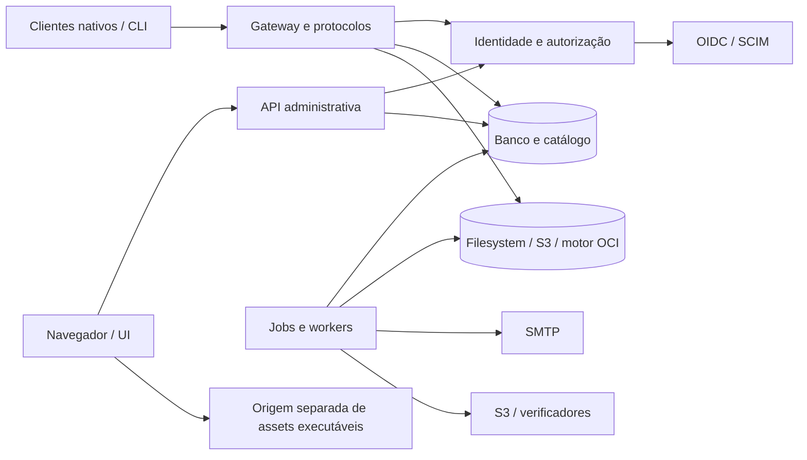

# Modelo de ameaças inicial — Private Registry

**Estado:** rascunho de fase 0. Identifica ativos, fronteiras e cenários prioritários; controles descritos como requisitos não são prova de implementação. Revisar junto dos ADRs, interfaces e testes de cada fase.

## Objetivo e escopo

Proteger confidencialidade de artefatos privados e metadata, integridade de publicações e políticas, disponibilidade operacional e recuperação após erro, revogação ou comprometimento. O modelo cobre o servidor self-hosted, clientes nativos, UI/API, storage, diretório OIDC/SCIM, jobs, CLI, backups e restore. Não assume que operador do host ou do storage é incapaz de ler bytes.

## Ativos prioritários

| Ativo | Propriedade a preservar | Impacto principal |
| --- | --- | --- |
| Pacotes, blobs, manifests, assets e metadata | Confidencialidade por workspace/repositório; digest e versão imutáveis | Exposição de código ou distribuição adulterada |
| Permissões, grants, estado de conta, policy e aliases | Integridade, precedência de revogação e trilha auditável | Leitura/publicação indevida ou bypass de revisão |
| Senhas, sessões, passkeys, tokens e credenciais de serviço | Segredo, escopo mínimo, validade e revogação | Tomada de conta ou automação |
| Chaves de configuração, assinatura e recuperação | Separação, rotação e recuperabilidade | Perda irrecuperável ou falsificação de backup/proveniência |
| Backup, receipts e recovery kit | Confidencialidade, autenticidade, freshness e completude verificável | DR falso ou restauração comprometida |
| Auditoria, eventos de segurança e métricas | Integridade, privacidade e atribuição correta | Investigação incompleta ou vazamento lateral |
| Disponibilidade de banco, storage, workers e protocolo | Isolamento de recursos e degradação segura | Interrupção de builds ou recuperação |

## Atores e capacidades

- **Usuário legítimo:** lê e/ou publica apenas nos escopos concedidos; pode perder acesso durante sessão, upload ou revisão.
- **Publicador malicioso ou comprometido:** envia archives/manifests hostis, metadata falsa, caminhos ambíguos ou volume excessivo; não deve executar código no servidor.
- **Conta de serviço comprometida:** usa credencial vazada para operações restritas; não deve herdar privilégios do criador nem criar namespaces arbitrários.
- **Atacante externo não autenticado:** explora endpoints de login, protocolos, parser, configuração pública e diferenças de resposta para enumeração ou negação de serviço.
- **Administrador da instalação:** altera configuração e opera backups; por função técnica pode alcançar dados, mas a UI/API não concede implicitamente download de pacotes privados.
- **Operador do host/banco/storage:** pode acessar filesystem, snapshots e bytes. O produto não promete confidencialidade contra esse ator; age/recovery material e procedimentos externos limitam exposição de backup conforme operação definida.
- **IdP, SMTP, S3 e serviços configurados:** dependências externas potencialmente indisponíveis, comprometidas ou apontadas a destinos não confiáveis. Nenhuma integração recebe egress irrestrito por default.
- **Operador de restore/verificador:** recebe material de recuperação com escopo e validade definidos; não deve restaurar sobre produção nem transformar saída do processo em prova autenticada sem trust separado.

## Fronteiras de confiança

As setas para IdP, SMTP e destinos S3 atravessam fronteiras de rede e devem ser configuradas explicitamente. A UI administrativa e conteúdo executável de usuários devem usar origens distintas. Banco, storage e motor OCI não são substitutos entre si para autorização; cada caminho de leitura deve passar por decisão atual e auditável.

## Cenários prioritários e controles exigidos

| Cenário de ameaça | Resultado a impedir | Requisitos/mitigações do plano | Evidência atual |
| --- | --- | --- | --- |
| IDOR, slug/digest enumeration ou erro de escopo | Descobrir/baixar conteúdo de outro workspace | Resolver contexto e autorizar antes de ler storage; IDs opacos; erros/listas/contadores isolados | IDs, workspaces e policies persistem nos dois engines; ainda não há auth middleware, repositórios, conteúdo ou rotas. Isolamento de dados acessíveis não implementado; exige testes de autorização reais nos dois bancos |
| Corrida entre upload, publicação, revisão e revogação | Conteúdo pendente ou sem permissão tornar-se distribuível | Revalidar policy no commit; version reservation; transação SQL/outbox; estados recuperáveis | Spikes OCI mostram que checagem no gateway não ordena commit remoto; sem solução produtiva |
| Path traversal, archive bomb, symlink, duplicata ou parser diferencial | Escrita fora do destino, consumo ilimitado ou conteúdo ambíguo | Normalizar caminhos e impor limites de bytes comprimidos/descomprimidos, entradas, profundidade e tempo | Sem parser de produção; testes por formato obrigatórios |
| Código de pacote executado no servidor | Comprometimento do processo/host | Nunca executar hooks, builds ou comandos de cliente; extração limitada e isolada | Decisão registrada no plano, ainda sem aplicação produtiva |
| SSRF, DNS rebinding ou redirect para rede interna | Acesso a metadata/cloud/serviços locais por URL configurada | Egress negado; destinos allowlisted por função; validar DNS, redirect e conexão; sem bypass global | Fixtures isoladas pontuais; política de egress do produto não provada |
| Revogação enquanto request OCI está em voo | Push commitado após acknowledgment de revogação | Definir instante/coordenação durável de commit, recovery e resultado incerto; não confiar em cancelamento | Reproduzido deterministicamente no spike 0.9; bloqueia aceite OCI |
| Blob/manifests OCI pendentes acessíveis por digest, mount ou alias | Distribuição antes de aprovação ou de grant atual | Gateway de alcance publicado qualificado por repo; validar todas as rotas e métodos; coordenar GC/pins | Mitigações experimentais 0.7/0.8/0.10, sem motor/adapter produtivo |
| Desativação SCIM contornada por senha, passkey, sessão ou token | Conta gerenciada continuar usando acesso após revogação | Estado de diretório vinculante; revogar sessões/tokens; bloquear métodos alternativos; preservar conta local separada | OIDC/SCIM básico provado; bloqueio de todos os métodos ainda não implementado |
| Brute force, enumeração de conta ou flooding de Argon2 | Acesso indevido, vazamento de identidades ou esgotamento de memória/CPU | Resposta genérica; limite por conta e fonte; hash dummy para usuário ausente; concorrência Argon2 bounded; buckets temporários limitados | `internal/auth`/`internal/authattempts` implementam 5 tentativas por conta e 20 por IP em 15 min, bucket cap de 50 mil e duas derivações concorrentes sem fila. Ainda sem router; identidade de origem depende do peer confiável e configuração futura de proxies |
| Canal SCIM falha sem alerta ou usuários ficam com estado obsoleto | Acesso permanece além do prazo de falha | Health baseado em reconciliação verificável, timer default 1h, bloqueio, UI e desbloqueio auditado | Authentik 2026.8.3 reportou `info`/timestamp antigo/queued após 503; health/freshness continua gap |
| Roubo/adulteração/replay de backup ou kit | Restore de dados não confiáveis ou indisponibilidade silenciosa | Age antes do upload; receipt assinado com trust separado; validar todo objeto antes do restore; freshness/anti-rollback e kit recuperável | Spikes 0.13–0.16 limitados por engine/fixture; sem backup completo/kit operacional |
| Restore reativa identidade ou credencial antiga | Acesso indevido após DR | Recovery mode, credenciais suspensas por padrão, rotação e reativação explícita/auditada | Requisito do plano; sem implementação |
| Perda, substituição ou exposição da chave mestra local | Segredos cifrados ficam irrecuperáveis ou são revelados | Arquivo separado do banco/diretório de dados, permissões privadas, recusa de overwrite, backup/recuperação e rotação testados | `registry init-master-key` cria arquivo Linux `0600`; `internal/mfa` persiste seeds TOTP com envelope autenticado. Backup/kit/rotação da chave não existem, então perda da chave já torna seeds persistidos irrecuperáveis |
| Jobs, GC, multipart, retries ou quotas sob falha/concorrência | Perda de objeto protegido, over-quota, tempestade de retry ou leak | Estado persistido, leases, idempotência, pins e reconciliação; limites e backpressure | Spikes pontuais; jobs/quotas de produção inexistentes; Floci admite dois winners em multipart condicional |
| Logs, métricas, erros ou UI revelam segredo/metadata privada | Vazamento lateral ou credencial recuperável | Redação, labels limitados, autorização de métricas, segredos write-only, audit mínima | Sem instrumentação geral de produto; bootstrap CLI exige TTY, não aceita senha em argumento/ambiente nem a registra, e persiste hash Argon2id. A chave mestra nunca é impressa/logada; `internal/mfa` não registra seed/códigos em logs e salva somente seed cifrado e hashes de recuperação; `internal/sessions` persiste somente hashes de bearer/CSRF. `internal/auth` retorna erros genéricos, mas nenhum fluxo está exposto por HTTP nem tem telemetria geral |
| Dependência/update comprometidos | Código malicioso entra em release | Versões fixadas, checksums/assinaturas, builds isolados, release assinada e procedimento offline | Gaps de CI/release e operação offline ainda abertos |
| Exaustão de CPU, memória, disco, file descriptors ou DB locks | Queda de serviço ou starvation de backup/restore | Limites por upload/concurrency, buffers bounded, prioridade interativa, pressão visível e falha sem apagar dados | Só limites de fixture; produto e benchmarks não existem |

## Invariantes de segurança para orientar implementação

1. Nenhum objeto é lido, listado ou contado antes da autorização para o escopo resolvido.
2. Receber bytes, armazená-los, aprovar e publicar são estados distintos; sucesso só é comunicado quando o protocolo representa corretamente o estado alcançado.
3. Um digest identifica conteúdo, nunca concede direito de acesso.
4. Revogação, mudança de policy e finalização de upload/publicação têm ordem explícita; estado incerto não vira sucesso por retry cego.
5. Falha ou silêncio de serviço externo não amplia acesso. Bloqueios de indisponibilidade são distinguíveis dos bloqueios por revogação/risco.
6. Nenhum backup é validado antes de verificar autenticidade/contexto, tamanho, integridade criptográfica e restauração real em destino descartável.
7. Egress exige destino e finalidade autorizados. Clientes de teste nunca dependem de credenciais ambient/cloud implicitamente descobertas.
8. Limites são impostos ao stream real, não somente a `Content-Length`; dados privados e credenciais não aparecem em logs/métricas.

## Critérios de atualização e limites

Revisar este modelo antes de cada nova fronteira externa, formato, storage, parser, mecanismo de identidade, decisão de egress ou forma de restore, e após incidentes/testes que contrariem um controle. Para cada ameaça, ligar controle a um teste de regressão/integration com a fronteira real. A tabela reflete apenas evidência existente no checkout em 2026-10-12; não constitui auditoria, threat assessment independente, certificação, garantia de ausência de malware nem validação de produção.
